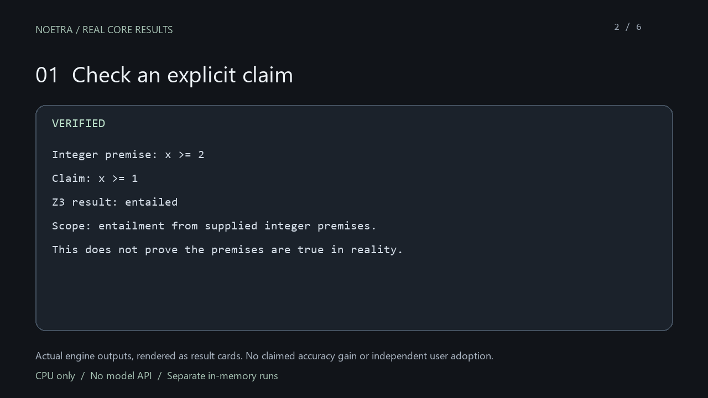

# NOETRA — Universal Cognitive Engine

**Give AI agents a checkable trail: evidence, formal logic and prerequisite plans.**

Local-first, open-source **MCP server · CLI · TypeScript SDK**. The core runs on
an ordinary CPU with Node.js; **no GPU, AI subscription or model API key needed**.
It stores attributed evidence, checks supplied integer constraints through Z3,
and plans from explicit dependencies. It does not replace your host AI.

[Open the recorded preview](https://huggingface.co/spaces/NOETRA2/noetra-demo) ·
[Try the engine locally](#try-it-in-one-minute) · [npm](https://www.npmjs.com/package/noetra) ·
[Connect your agent](#connect-an-ai-host) · [Tool API](docs/api/README.md) ·
[Launch status](docs/launch/README.md)

**Developer alpha `0.1.0-alpha.4`.** Check [release availability](docs/launch/README.md)
for current npm, MCP Registry and hosted-demo status. Source and local tarball
installation are available independently of those services.
Image-to-3D is an optional, unfinished advanced workflow; no validated 90% fidelity
claim exists.

## Try it in one minute

With Node.js 24.11+ in 24.x, or Node.js 26+, run the published exact version:

```sh
npx --yes noetra@0.1.0-alpha.4 demo
```

Open **http://127.0.0.1:7860**. Check a claim, toggle a missing prerequisite or
inspect an evidence record. These controls execute the actual engine, not canned
results. Every run has a separate in-memory database, discarded afterward. No
model downloads or optional 3D tools are installed. Stop with Ctrl+C.

No installation yet? The [free online preview](https://huggingface.co/spaces/NOETRA2/noetra-demo)
lets you inspect real recorded examples and the walkthrough. It displays stored
results; it does not run the engine remotely. The command above runs the actual
engine locally. The npm artifact was checked against the reviewed upload and a
fresh anonymous registry installation passed the MCP/SQLite/Z3 self-test.



[Watch the 60-second result walkthrough](docs/media/noetra-demo-60s.mp4) ·
[How to reproduce the examples](docs/demo/README.md)

The walkthrough presents actual engine outputs as labelled cards; it is not a
browser recording. [Capture provenance](docs/demo/PROVENANCE.md).

## A result you can inspect

| Example | What NOETRA does | Scope |
| --- | --- | --- |
| Integer premise `x ≥ 2`, claim `x ≥ 1` | Z3 checks entailment | Valid only for the supplied integer premises |
| Same premise, stronger claim `x ≥ 5` | Returns a counterexample | A formal counterexample, not a real-world measurement |
| Build → review → release, tests missing | Reports blocked actions | Actions/effects are supplied; nothing is published |
| One observed test result | Stores origin, digest and limitations | Remains an untrusted observation, not proof |

Maintained by [NOETRA2](https://github.com/NOETRA2). Core code is MIT licensed.
Optional providers have their own licences and are not bundled or installed
automatically. NOETRA is independent of Nexa apps and is not endorsed by Tencent,
OpenAI, REA, Blender or other upstream projects.

## What is implemented

- Evidence records, assumptions, unknowns and revision history in project-local
  SQLite memory; explicit local export/removal.
- Structured world graphs, rule deduction and contradiction detection.
- Z3/WASM checks for supplied integer-linear constraints, entailment and
  counterexamples. A formal result is scoped to its premises, not empirical truth.
- Dependency/precondition planning and ranking host-authored candidates.
- Eleven default MCP operations; 23 optional reconstruction operations when
  deliberately configured, plus one optional Ghidra route.
- Optional REA integration for permission-scoped software investigation.
- Reference preservation, source hashes, calibrated-silhouette experiments,
  bounded part correction and local mesh export/render validation.
- Automatic observed-colour families, connected image regions, boundaries and
  texture directions. Colour regions are not verified anatomical parts.
- Real xatlas UV generation and Blender PBR-map baking; a measured-palette
  preview uses an existing attributed layout and preserves original geometry.

## Install from this repository

Prerequisite: Node.js **24.11+ in the 24.x line, or Node.js 26+** and npm.
No GPU is needed for the core reasoning/MCP tools.

```sh
git clone https://github.com/NOETRA2/NOETRA.git
cd NOETRA
npm ci --ignore-scripts
npm run build
node dist/apps/cli/src/index.js help
node dist/apps/cli/src/index.js doctor
node dist/apps/cli/src/index.js test
```

GitHub's **Code → Download ZIP** also provides the source; extract it and run
the npm commands from that folder. Once the exact release appears under the
verified owner **harshavardhan2** on npm, it can be run without a source build:

```sh
npx --yes noetra@0.1.0-alpha.4 test
npx --yes noetra@0.1.0-alpha.4 demo
```

Use a project-local installation for durable AI-host registration, rather than
relying on an npm temporary cache path. Availability and publish verification
are tracked in the release-status document; these commands are not a claim that
an unverified package or hosted endpoint is live.

To build a local distributable:

```sh
npm pack
```

## Connect an AI host

```sh
node dist/apps/cli/src/index.js setup --client codex --scope project
node dist/apps/cli/src/index.js setup --client cursor --scope project
node dist/apps/cli/src/index.js setup --client claude --scope project
```

Setup previews configuration first. Cursor/Claude JSON setup requires a reviewed
`--apply --yes`; Codex registration prints a TOML snippet for manual review.
Reconnect the host afterward. No existing AI-client or REA settings are silently
replaced. See [installation](docs/installation/README.md).

## Models and tools used

| Component | Role | What it does not establish |
| --- | --- | --- |
| Codex host agent | Interpreted the brief, authored scripts/candidates and reviewed output | Exact host model identifier was not recorded in the original experiment |
| Built-in image-generation tool | Created reference/concept artwork | Those images are not renders of a mesh; exact image-model/version was not recorded |
| **Tencent Hunyuan3D-2mini Turbo** | Actual learned lion geometry | Hidden surfaces, accurate anatomy, physical scale and materials remain unverified |
| TripoSR + U2Net/rembg | Optional local shape backend / foreground estimation | Not automatically fused detailed multi-view reconstruction |
| Blender 5.2.2 LTS | Mesh assembly, PBR baking, export and actual renders | A successful render is not an accuracy score |
| xatlas 0.0.11; OpenCV; NumPy/SciPy | UV charts, measured appearance, image/geometry calculations | Colour clusters do not identify anatomy or recover depth |
| Z3 | Checks explicit formal constraints | Does not judge artistic quality or physical truth |
| REA 6.7.0 / optional Ghidra | Authorized software investigation | They are analysis tools, not image-to-3D generators |

The lion model revision is `f90a0f7df7d5e6f71109cf333f6a95a0ae3194a6`;
the upstream source commit is `f8db63096c8282cb27354314d896feba5ba6ff8a`.
The pinned manifest includes full checkpoint/source hashes. **Model weights,
third-party applications, private accounts and local model caches are excluded.**

Hunyuan is a separately licensed optional provider, not MIT-licensed model
weights. Review [its licence](docs/third-party/HUNYUAN-LICENSE.txt),
[notice](docs/third-party/HUNYUAN-NOTICE.txt) and
[model/source provenance](packages/reconstruction/provider-manifests/hunyuan3d-2mini-turbo.json)
before provisioning it. Its licence contains territory and use restrictions.
Powered by Tencent Hunyuan when that provider is enabled; Tencent does not
sponsor, endorse or operate this independent project.

## Real mesh demonstrations

The images below are **Blender renders of actual meshes**, not generated concept
pictures presented as 3D output. Details, settings and limitations are in
[comparisons](docs/comparisons/README.md).

### Lion: standalone Blender mesh beside the NOETRA workflow


**Left: without NOETRA**, a new host-authored procedural lion built directly in
Blender from primitives, remeshing and solid geometry. No NOETRA code or learned
shape model generated that mesh. **Right: with NOETRA**, the existing lion created
through its **Hunyuan3D-2mini Turbo** workflow. Both pictures render real meshes
using the same clay material, lighting, view directions and normalized height.
The procedural lion is stylized; these different methods are **not a controlled
test of NOETRA's quality or accuracy**. The downloadable mesh, script and second
angle are in [comparisons](docs/comparisons/README.md).

We also ran a separate direct Hunyuan inference with NOETRA bypassed and otherwise
matching inputs/settings. That result is identical to the workflow's raw mesh;
the report preserves this evidence. No numerical accuracy gain is claimed.

## Validation and limitations

The local core TypeScript/build checks, 71 Node tests and CLI protocol self-test passed. The reconstruction
Python suite and focused cache/region tests passed (156 tests across the recorded
runs). The example meshes were actually exported, reimported and rendered.
GitHub Actions results, once available, are separate from these local checks.

The lion mesh and painting remain partial. Accurate facial anatomy, semantic
part-to-mesh correspondence, calibrated detailed multi-view fusion, intrinsic
albedo/PBR recovery and reliable unseen geometry are unfinished. The automatic
appearance-readiness gate remains false; an explicitly requested unverified paint
preview does not override it or replace the accepted model.

**Accuracy is not measured by triangle count, watertightness, successful export
or a visually pleasing screenshot.** We need a defined metric, independent
ground-truth 3D data, held-out inputs and reproducible evaluation before making
a numerical fidelity claim such as 90%.

## Documentation

[Architecture](docs/architecture/README.md) · [Tool API](docs/api/README.md) ·
[Security](docs/security/README.md) · [REA](docs/rea-integration/README.md) ·
[Reconstruction](docs/RECONSTRUCTION.md) · [Appearance analysis](docs/APPEARANCE-ANALYSIS.md) ·
[Surface painting](docs/SURFACE-PAINT.md) · [Third-party notices](THIRD_PARTY_NOTICES.md)

## Development

```sh
npm ci --ignore-scripts
npm run check
```

Python reconstruction tests require separately provisioned local dependencies;
model inference is optional and is not run merely by installing the core package.
Report reproducible problems through GitHub Issues, with sanitized inputs and
logs. Do not upload credentials, private images, AI-client settings or model weights.
