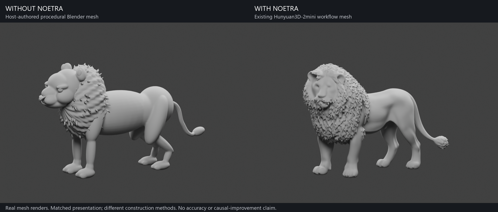
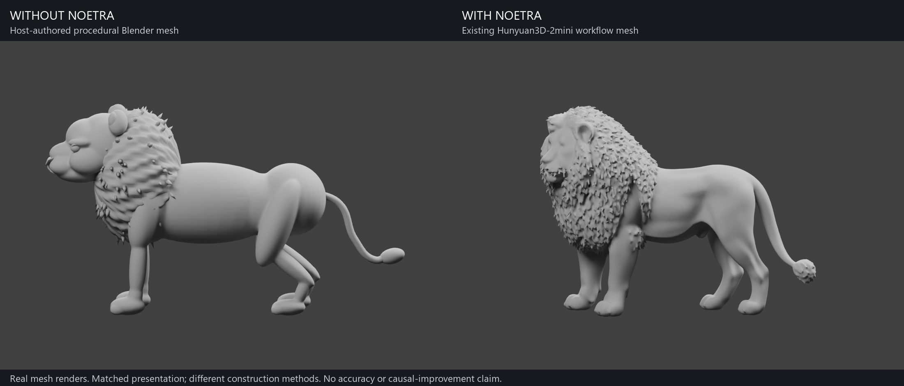
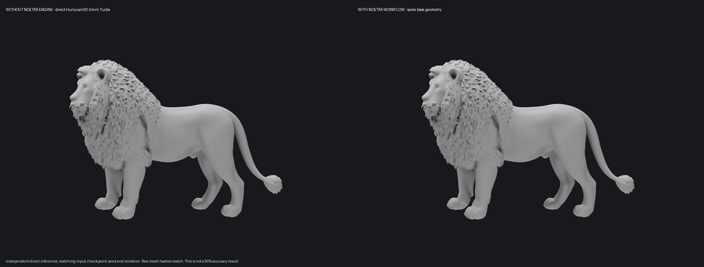
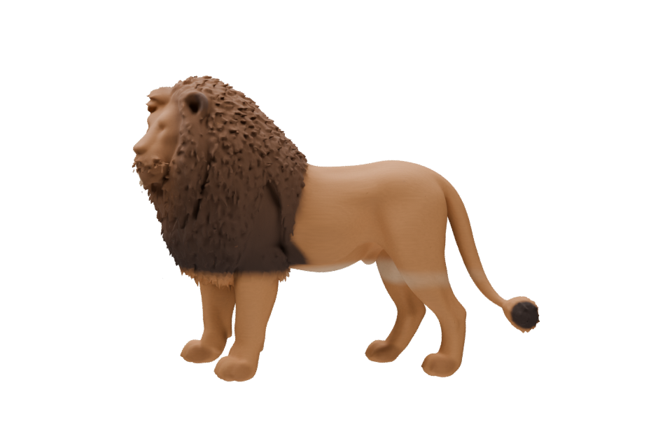
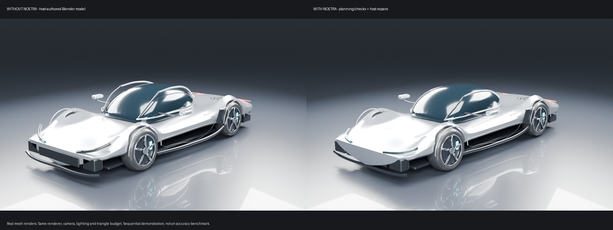

# Real mesh comparisons

All gallery pictures here are actual Blender renders of saved triangle meshes.
Reference/concept artwork is not passed off as a model render. The published
core source is a publication snapshot with a corrected CLI self-test; these documents and benchmarks describe
what the software did and what remains unfinished.

## Lion: new standalone Blender mesh, without NOETRA

The **left** mesh is a new host-authored procedural Blender study of the same
standing male-lion subject. The script creates its own body, legs, paws, facial
geometry, mane and tail; it does not import NOETRA or invoke a learned shape
model. Its GLB was exported and hash-frozen before the existing NOETRA mesh was
opened for rendering. It contains no copied vertices or photographic planes.

The **right** mesh is the existing Hunyuan3D-2mini Turbo result orchestrated by
NOETRA. Both use matching neutral clay, studio lighting, view directions, render
resolution and sampling; height/grounding are normalized for presentation.
Proportions remain unchanged. The new procedural result is stylized, not an
exact reconstruction. Construction methods and geometry budgets differ, so this
is a **workflow illustration, not a controlled ablation or accuracy benchmark**.
It does not establish that NOETRA improves the same underlying generator.

[Download the actual without-NOETRA mesh](../models/lion-without-noetra-procedural.glb)
· [Reproduce the Blender build](../../benchmarks/build_standalone_lion.py)
· [Build and render evidence](lion-blender-comparison.json)

The separately matched direct-model experiment below is retained to distinguish
the effect of orchestration from differences between construction methods.

## Lion: direct underlying model and NOETRA workflow

A new standalone inference was run directly against the pinned upstream
Hunyuan3D pipeline. The baseline script imports no NOETRA SDK, engine or runtime
modules. It shares the already-frozen RGBA conditioning image (including its
earlier U2Net foreground matte), checkpoint, FP16 precision, seed 12345, eight
steps, resolution 192 and 1024 extraction chunks with the existing assisted run.
Both use the same custom mapped-tensor/sequential-offload memory strategy for
the 4 GB laptop GPU. This is not a comparison against upstream default loading
or an independently estimated input matte.

**Result: identical raw GLB SHA-256 and identical ordered vertex positions.**
Both meshes contain 81,326 vertices and 162,196 triangles. The maximum ordered
coordinate difference is zero. The direct script generated the baseline anew;
the assisted mesh was not copied or relabelled as an independent run.

This demonstrates that NOETRA orchestrates this existing shape model; it does
not demonstrate that NOETRA makes the underlying learned geometry more accurate.
The shared Blender fixture uses identical camera, lights, material, resolution
and sampling. The direct inference took 71.75 seconds in this run. Timing scopes
and warmed caches differ from the earlier assisted run, so no speedup is claimed.

### Exact model provenance

- Mesh model: **Tencent Hunyuan3D-2mini Turbo**.
- Model revision: `f90a0f7df7d5e6f71109cf333f6a95a0ae3194a6`.
- Source commit: `f8db63096c8282cb27354314d896feba5ba6ff8a`.
- Weight SHA-256: `bdbcef30dd0149a281e17d5b5b1fdad1122c904e098a42f3100e04e03c247bc4`.
- Shared conditioning SHA-256: `5d5f23f78e566e56188fa0f3ba0bd742b880a0d31df6e6dfa97ad4c7034da9e9`.
- Hardware/software: RTX 3050 Laptop 4 GB; PyTorch 2.6.0+cu124; Blender 5.2.2 LTS.
- Peak allocated Torch CUDA memory: 2,571,237,376 bytes; not total device use.
- Exact historical host-agent and built-in image-generator model IDs were not
  recorded; no guessed identifiers are supplied.

The references were generated artwork, not calibrated photographs. Only the
primary image conditioned this learned model; six auxiliary references were not
fused into its shape. Eyes, muzzle, paws, mane, hidden surfaces and scale remain
approximate. Watertightness and triangle count do not prove visual fidelity.

[Direct result](lion-direct-baseline.json) · [Geometry comparison](lion-comparison.json)
· [Standalone benchmark script](../../benchmarks/direct_hunyuan_baseline.py)

### Experimental measured-colour pass

NOETRA also analyzed seven views for observed colour families and image regions,
then painted an explicitly requested separate preview using an existing authored
region layout. Software selected actual reference-pixel palette endpoints,
generated/reused verified xatlas UVs and baked colour, roughness and normal maps.
The mesh stayed unchanged. It did not paste the photograph onto the surface or
add separate facial parts. Roughness, grain and placement are still hypotheses.
The painting is visibly unfinished and is not claimed as a reference match.

## Sports car: structured checks and host-implemented repairs

The same Codex host authored both procedural Blender studies. The baseline was
completed and hash-frozen before NOETRA calls. NOETRA recorded requirements and
measurements, ran Z3 checks, ranked host-authored repair options and structured a
dependency plan; the host implemented the changes. Both use 146 objects and
92,034 triangles with the same presentation. No learned mesh model generated
these car meshes. Separate AI concept pictures are not used as mesh evidence.

| Measured quantity | Without NOETRA | With NOETRA | Author-chosen target |
| --- | ---: | ---: | ---: |
| Length | 4736 mm | 4600 mm | 4600 mm |
| Width excluding mirrors | 2075 mm | 2002 mm | 2000 mm |
| Height | 1149 mm | 1142 mm | 1160 mm |
| Wheelbase | 2700 mm | 2700 mm | 2700 mm |
| Largest audited trim/support distance | 126 mm | 37 mm | Lower preferred |

Length/width agreement and attachment improved; height became slightly worse.
The strict width target still misses by about 2 mm. These rounded, supplied
measurements are not manufacturing clearances or engineering certification.
This sequential, non-blinded example does not establish a general causal gain;
a plain-agent second review could also have found these issues.

[Car measurement evidence](car-measurements.json)

## Why we do not claim 90% accuracy

There is no independent ground-truth 3D lion, calibrated correspondence or defined
accuracy metric for these examples. Matching another output, satisfying a size
constraint or rendering successfully is not “90% accurate”. A future numerical
claim needs a specified metric, representative held-out data, independent ground
truth and reproducible evaluation. The current project has no validated 90%
fidelity or general model-improvement claim.
